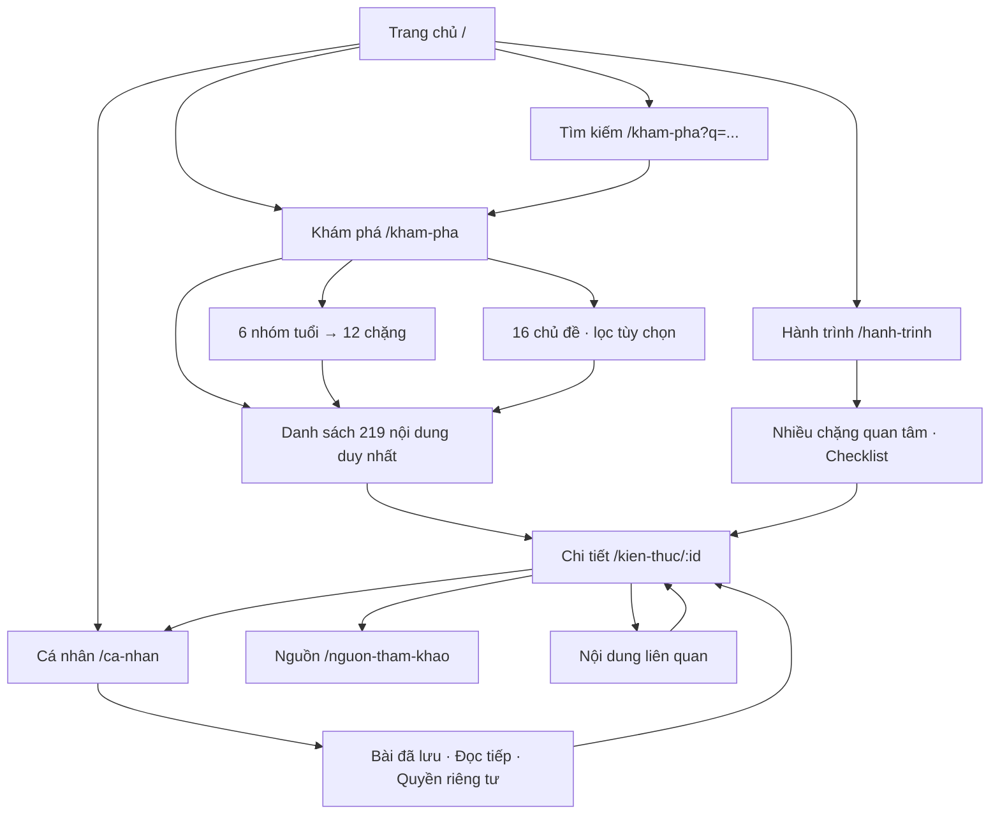
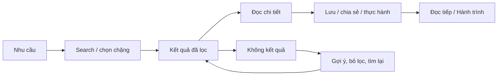

# Sitemap V2 — Đề xuất, chưa triển khai
Baseline 16b8762. Một điều hướng theo mục tiêu, không đưa cấu trúc dữ liệu nội bộ lên giao diện.

## Hợp đồng định tuyến (đề xuất, chưa đổi URL thật)
| Trang | URL đích đề xuất | Tương thích |
|---|---|---|
| Trang chủ | / | Giữ nguyên |
| Khám phá & tìm kiếm | /kham-pha?q=&stage=&topic=&kind=&page= | /thu-vien, /tim-kiem, /hoc-cung-con tiếp tục hoạt động hoặc chuyển hướng có giữ query; không làm lộ draft |
| Đọc | /kien-thuc/:kind/:id | Giữ /bai-viet/:slug cho legacy hoặc redirect đúng; không xung đột ID giữa legacy/article/lesson |
| Hành trình | /hanh-trinh | Giữ local checklist hiện có |
| Cá nhân | /ca-nhan | /da-luu ánh xạ tab đã lưu; giữ bookmark cũ |
| Nguồn | /nguon-tham-khao | Giữ nguyên; footer và nguồn trong bài |
| Quản trị, raw preview, demo | Route riêng hiện có | Không đưa vào navigation; giữ quyền và cảnh báo mô phỏng |

Mỗi link #az-ID và #lesson-ID cũ cần chuyển đến đúng chi tiết kể cả refresh, browser back và deep link; fragment không gửi server nên cần xử lý tương thích client tại route cũ hoặc giữ fallback. Không tự động redirect route protected thành public. Quyết định URL canonical cuối cùng ở UX-01 trước khi code. **URL sơ đồ rút gọn**, hợp đồng chi tiết dùng kind/id.

UX-01 accepted on Combined DEV (26/11/2026): /kham-pha là entry chung trên Combined DEV; /kien-thuc/:kind/:id trả 307 đến trình đọc hiện tại (legacy hoặc /hoc-cung-con?stage=…#…). URL cũ còn hoạt động; không redirect Production. Trang chi tiết thực sự, search/ranking và /ca-nhan được triển khai ở UX-02/06/07/08, không coi là hoàn tất UX-01.

## Nhóm tuổi hiển thị
| Nhóm gọn trên trang chủ | Chặng atlas |
|---|---|
| Chuẩn bị đón bé | prenatal |
| 0–5 tuổi | baby, toddler, preschool |
| 6–17 tuổi | school, preteen, teen |
| 18–22 tuổi | adult |
| 23–59 tuổi | early-adult, midlife |
| 60+ tuổi | older, later-life |

Prenatal chỉ là chặng trước khi sinh trong atlas; hậu sản và các stage legacy phải giữ mapping theo inventory đã có, không tự đổi nghĩa dựa vào label. Giữ 12 stage legacy và 192 ô (12×16), 173 ô áp dụng có draft, 19 không ưu tiên. Không nhân bản 72 legacy. Không mặc định mọi người là cha/mẹ, chọn tất cả nếu chưa có sở thích; lọc nhiều chặng là OR, nhiều nhóm khác là AND; URL là nguồn trạng thái khám phá. Mỗi kết quả có kind, stable ID, title, summary, stage, topic, href; nguồn, nội dung dài tải theo nhu cầu và giữ nguyên quyền. Dữ liệu 72 legacy đọc từ nguồn live đúng hợp đồng; 126+21 hiện đóng gói, không giả định đã ở CMS.

## Luồng cốt lõi

Không có tài khoản thật, dữ liệu đồng bộ hoặc AI ở scope V2.
