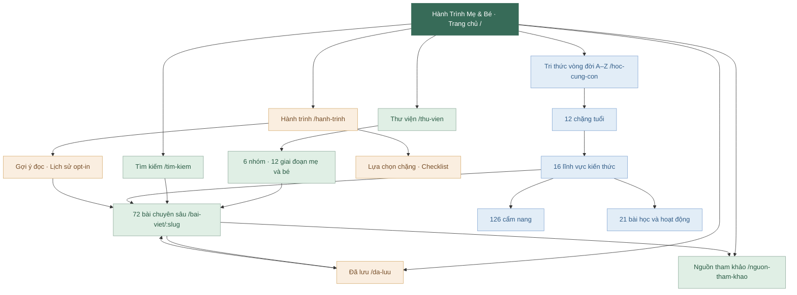
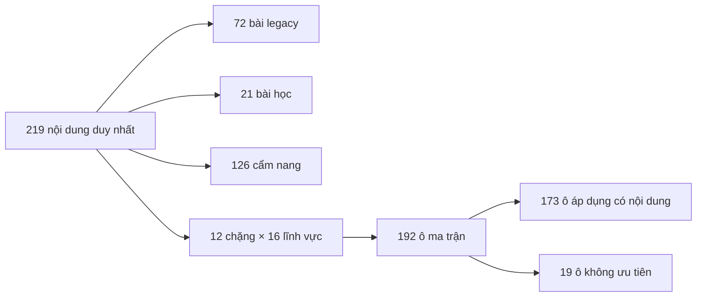
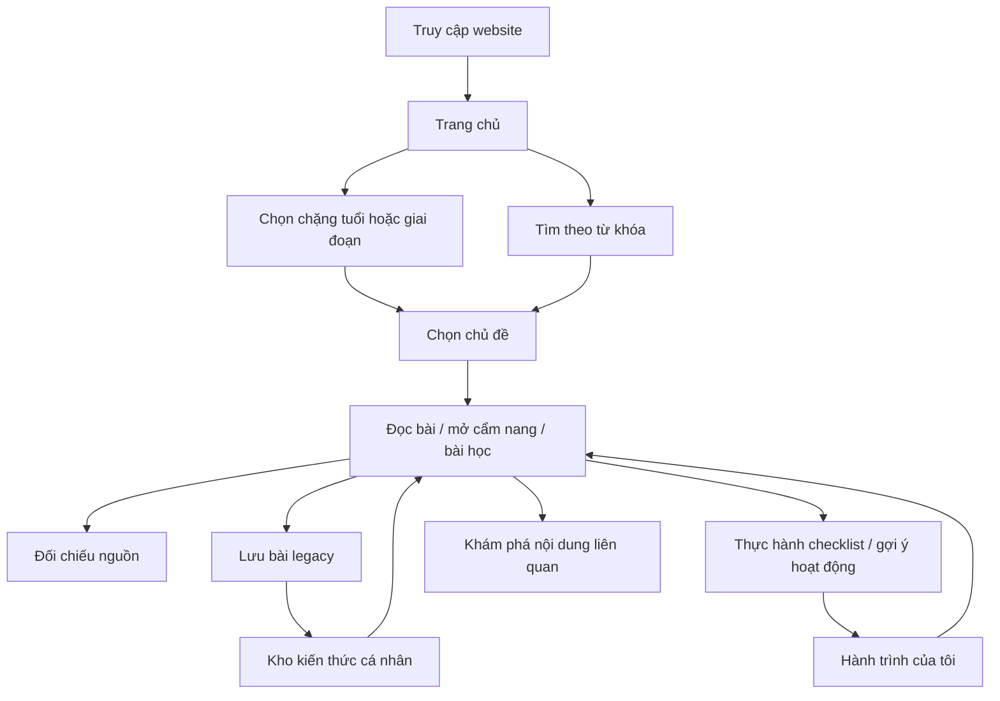
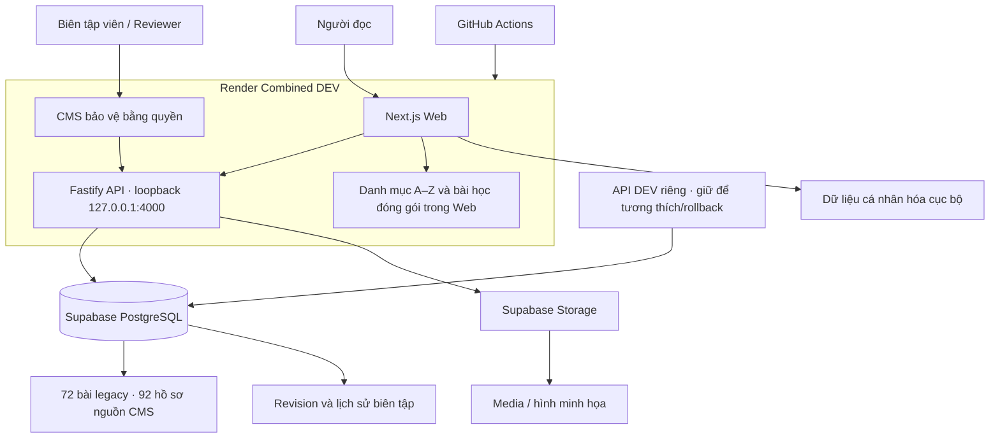
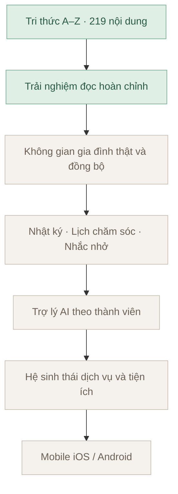

# Sơ đồ website và hệ sinh thái Hành Trình Mẹ & Bé

**Ngày:** 26/11/2026 · **Baseline ứng dụng:** `16b8762` · **Môi trường:** Combined DEV  
**Nghiệm thu:** [Post-deploy QA 219/219](https://github.com/kios-saks/demo/actions/runs/45765933955) · [Báo cáo PR](https://github.com/kios-saks/demo/pull/1#issuecomment-7184181175)

Tài liệu mô tả hiện trạng đã nghiệm thu kỹ thuật, không đồng nghĩa với phê duyệt chuyên môn hoặc phát hành Production. Định hướng: hệ sinh thái tri thức và đồng hành suốt vòng đời; Web First – API First – Mobile Last.

## 1. Sitemap dành cho người đọc

### Nhóm thư viện mẹ và bé (72 bài)

| Nhóm | Giai đoạn |
|---|---|
| Chuẩn bị mang thai | Chuẩn bị mang thai |
| Thai kỳ | 3 tháng đầu, 3 tháng giữa, 3 tháng cuối |
| Sau sinh | Hậu sản |
| Những tháng đầu đời | Sơ sinh, nhũ nhi |
| Tuổi thơ | Tập đi, mầm non |
| Cùng con trưởng thành | Tiểu học, thiếu niên, trưởng thành |

Sáu nhóm và 12 giai đoạn ở đây là phân loại thư viện mẹ và bé, khác với 12 chặng tuổi của bản đồ A–Z. 72 bài legacy được tham chiếu trong A–Z, không cộng hai lần.

## 2. Bản đồ tri thức vòng đời

| Chặng | Định hướng | Nội dung |
|---|---|---:|
| Trước khi sinh | Chuẩn bị mang thai, thai kỳ và đón bé | 32 |
| 0–12 tháng | Năm đầu đời | 19 |
| 1–2 tuổi | Tự chủ và khám phá | 16 |
| 3–5 tuổi | Học qua chơi | 16 |
| 6–10 tuổi | Học tập và tình bạn | 17 |
| 11–13 tuổi | Dậy thì và bản sắc | 18 |
| 14–17 tuổi | Định hướng tương lai | 18 |
| 18–22 tuổi | Bước vào đời | 19 |
| 23–34 tuổi | Xây dựng cuộc sống | 16 |
| 35–59 tuổi | Trung niên và chuyển tiếp | 16 |
| 60–74 tuổi | Sống khỏe và chủ động | 16 |
| 75+ tuổi | Chất lượng sống và phẩm giá | 16 |
| **Tổng** | **12 chặng** | **219** |

### 16 lĩnh vực

| Sức khỏe và phát triển | Học tập và công nghệ | Đời sống và xã hội | Năng lực tự lập |
|---|---|---|---|
| Dinh dưỡng | Giáo dục & học tập | Quan hệ xã hội | Tài chính |
| Sức khỏe | Trường học & cơ sở đào tạo | An toàn | Nghề nghiệp |
| Tâm lý & cảm xúc | Tư duy | Sinh hoạt | Pháp luật & xã hội |
| Sinh lý & cơ thể | Công nghệ & AI | Năng khiếu | Kỹ năng sống |

173 ô có nội dung tham khảo ở trạng thái draft, không phải 173 ô đã đủ hoặc đã thẩm định. Mục trường học cung cấp tiêu chí lựa chọn và liên kết tra cứu chính thức, không phải cơ sở dữ liệu xếp hạng trường.

## 3. Luồng trải nghiệm

Lưu bài, checklist theo giai đoạn và lịch sử đọc hiện lưu trên thiết bị/trình duyệt. Không coi bài học A–Z có đồng bộ tài khoản hoặc checklist tương tác nếu chỉ hiển thị hướng dẫn thực hành.

## 4. Kiến trúc kỹ thuật

- Web sử dụng URL thân thiện với người đọc; middleware rewrite đến reader nội bộ chỉ theo chính sách đã cấu hình. 
- Trên Combined DEV, API nội bộ qua loopback; không coi toàn bộ 219 nội dung đã được lưu trong Supabase.
- CMS và raw preview API không thuộc điều hướng đọc. Gia đình mô phỏng được ẩn khỏi menu nhưng vẫn giữ route riêng với cảnh báo dữ liệu mẫu. Không gian gia đình thật chỉ hiển thị khi được cấu hình.
- Giữ noindex/nofollow, quyền truy cập, trạng thái draft và các cảnh báo chuyên môn; không mở Production.

## 5. Hướng phát triển

| Hạng mục | Trạng thái |
|---|---|
| Hệ sinh thái tri thức, 219/219 | Nghiệm thu kỹ thuật DEV PASS |
| Reader Experience Polish | Nghiệm thu kỹ thuật DEV PASS |
| Tài khoản và không gian gia đình | Có nền tảng và demo đã kiểm thử; mở rộng tạm dừng theo quyết định chủ dự án |
| Nhật ký, lịch khám, lịch tiêm, nhắc nhở | Định hướng, chưa nghiệm thu |
| Trợ lý AI cá nhân hóa | Hoãn đến khi nền tảng ổn định |
| Giáo dục, chăm sóc, sản phẩm và tiện ích | Định hướng, chưa nghiệm thu |
| Mobile | Sau cùng; prototype không đồng nghĩa ứng dụng phát hành |

Thứ tự các bước tương lai là đề xuất để tham chiếu, không thay thế quyết định ưu tiên trong [roadmap](ecosystem-roadmap.md).

## 6. Bằng chứng và mã nguồn đối chiếu

- [Baseline 16b8762](https://github.com/kios-saks/demo/commit/16b87629058c1a40304e4ff4f1d5eac252af9a5b)
- [CI 5/5 jobs](https://github.com/kios-saks/demo/actions/runs/45758373690)
- [Render deployment LIVE](https://dashboard.render.com/web/srv-dc19cibl550s73drji5g/deploys/dep-dc3soe3l550s73fgalng)
- [Post-deploy 219/219 và READER_POLISH_READY](https://github.com/kios-saks/demo/actions/runs/45765933955)
- [Reader Experience Polish](reader-experience-polish-2026-11-26.md)
- [Content Pipeline Recovery](content-pipeline-recovery-2026-11-26.md)
- [Reader navigation](../apps/web/lib/reader-navigation.ts), [middleware](../apps/web/middleware.ts), [atlas](../apps/web/app/hoc-cung-con/life-course-atlas.json), [inventory](../apps/web/app/hoc-cung-con/life-course-inventory.json).
- Kiểm thử API xác thực riêng SKIP do thiếu token; không làm mất hiệu lực các kiểm thử CMS và Open Reader đã PASS nhưng không được coi là kiểm thử token độc lập.

**Quy tắc cập nhật:** cập nhật báo cáo khi đổi điều hướng, dữ liệu, phân quyền, kiến trúc hoặc ưu tiên roadmap. Các số liệu và trạng thái phải gắn với commit/bằng chứng cụ thể.
